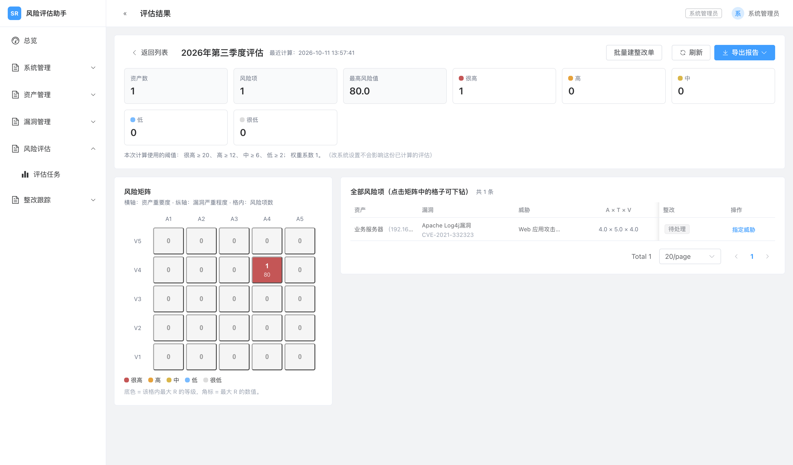
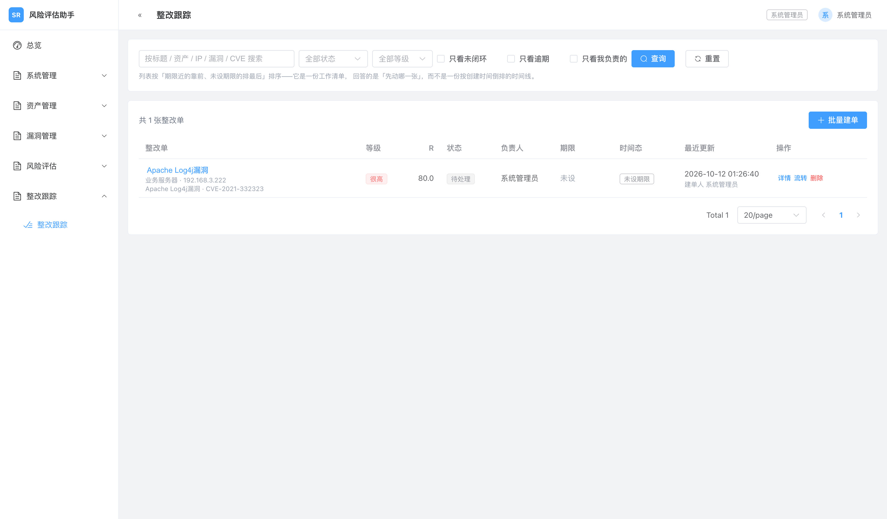

# 网络安全风险评估助手（sec-risk-assistant）

面向企业/团队内部使用的网络安全风险评估系统，打通  
**资产梳理 → 扫描报告导入 → 风险量化 → 整改跟踪 → 报告输出**全流程闭环，  
并为接入第三方威胁情报 API、对外暴露 MCP 能力预留扩展位。

| 项       | 内容                                                                    |
| -------- | ----------------------------------------------------------------------- |
| 形态     | **纯 Web 应用**（Vue SPA + Nginx 反向代理 + Go API + 独立文档渲染服务） |
| 技术栈   | Go 1.25 / Vue 3.5 / TypeScript 5.9 / MySQL 8.4 / C# .NET 10             |
| 数据契约 | **18 张表 / 70 个接口操作 / 50 条路径**（实测数）                       |
| 质量基线 | 安全控制项 **90 项**，最近一次全量回归 **全部通过**                     |






## 目录

- [网络安全风险评估助手（sec-risk-assistant）](#网络安全风险评估助手sec-risk-assistant)
  - [目录](#目录)
  - [功能范围](#功能范围)
  - [技术栈](#技术栈)
  - [架构与容器编排](#架构与容器编排)
  - [快速开始](#快速开始)
    - [环境要求](#环境要求)
    - [首次启动](#首次启动)
    - [全栈容器化运行](#全栈容器化运行)
  - [常用命令](#常用命令)
  - [项目结构](#项目结构)
  - [文档地图](#文档地图)
  - [质量保障](#质量保障)
  - [工程硬约束](#工程硬约束)
  - [许可](#许可)

---

## 功能范围

| 模块           | 能力                                                                                    |
| -------------- | --------------------------------------------------------------------------------------- |
| **认证与授权** | 登录 / 强制改密 / httpOnly Cookie 会话 + CSRF / 三级角色 / 动态路由权限 / 审计日志      |
| **资产与字典** | 资产台账、资产分组（物化路径）、业务字典、Excel 批量导入（两阶段 + 行级报错）           |
| **文件与解析** | 上传三重校验 + 哈希去重、Nessus / OpenVAS / 通用 Excel 解析、漏洞清单与资产关联         |
| **风险评估**   | GB/T 20984 相乘法（`R = A × T × V`）、定点整数运算、配置快照、风险矩阵热力图下钻        |
| **报告导出**   | Word（C# OpenXML）/ Excel（excelize）/ PDF（Gotenberg）三格式，7 节报告结构，流式不落库 |
| **整改跟踪**   | 状态机（5 状态 9 条边）、必填说明、打回 / 风险接受、逾期三档、批量建单幂等              |
| **首页统计**   | 风险分布、整改进度、逾期/即将到期，**口径绑定到具体评估**并回显                         |

---

## 技术栈

**前端**（`web/`）

| 依赖                     | 版本                   | 说明                                            |
| ------------------------ | ---------------------- | ----------------------------------------------- |
| vue / vue-router / pinia | 3.5.43 / 5.4.0 / 4.0.3 | Composition API + 动态权限路由                  |
| vite / typescript        | 8.3.4 / 5.9.x          | 构建与类型                                      |
| tailwindcss              | 4.3.3                  | CSS-first 配置                                  |
| element-plus             | 2.14.7                 | UI 组件库（与 Tailwind 分层共存，见 `docs/08`） |
| echarts / vue-echarts    | 6.1.0 / 8.3.2          | 风险矩阵与统计图表                              |
| openapi-typescript       | latest                 | 由 `docs/openapi.yaml` 生成接口类型             |

**主服务**（`server/`，Go 1.25）

| 用途           | 选型                                                     |
| -------------- | -------------------------------------------------------- |
| Web 框架 / ORM | Gin v1.12.0 / GORM v1.31.2                               |
| 数据库迁移     | golang-migrate v4.20.1（**显式 SQL，不用 AutoMigrate**） |
| 认证 / 哈希    | golang-jwt v5 / argon2                                   |
| 配置 / 校验    | viper + godotenv / validator v10                         |
| Excel / XML    | excelize/v2 / 标准库 `encoding/xml`（零依赖）            |

**文档渲染服务**（`services/docgen/`）：C# / .NET 10 LTS + raw OpenXML SDK，`JSON → DOCX` 二进制流。

**依赖服务**：MySQL 8.4 LTS、Gotenberg（Chromium 渲染 `HTML → PDF`）。

---

## 架构与容器编排

```
浏览器 (Vue 3 SPA + Element Plus)
      │  HTTPS
      ▼
   Nginx ──── 静态资源 (web/dist)
      │
      │  /api 反向代理
      ▼
  Go 主服务 (Gin) ── GORM ── MySQL 8.4
      │
      ├─ 文件存储（本地卷，与 Web 根物理隔离）
      ├─ 报告解析（标准库 encoding/xml + excelize）
      ├─ Excel 导出（excelize）
      ├─ PDF  导出 ──► Gotenberg 容器（仅内网）
      └─ DOCX 导出 ──► C# docgen 服务（仅内网）
```

`docker-compose.yml` 编排 5 个容器。**本机开发与服务器生产共用同一份编排**，仅靠 `.env` 区分环境。

| 容器        | 职责                                      | 对外暴露                                 |
| ----------- | ----------------------------------------- | ---------------------------------------- |
| `mysql`     | MySQL 8.4 LTS                             | 本机 `13306`（避开已装 MySQL 的 `3306`） |
| `server`    | Go 主服务（API / 解析 / 风险计算 / 编排） | 经 Nginx，本机 dev 为 `8080`             |
| `web`       | Nginx：静态资源 + `/api` 反代             | `${WEB_PORT:-8000}`                      |
| `gotenberg` | HTML → PDF                                | **否**（仅 `secrisk-internal` 网络）     |
| `docgen`    | JSON → DOCX                               | **否**（仅 `secrisk-internal` 网络）     |

> ⚠️ `internal: true` 网络上的 `ports` 会被 Docker **静默丢弃**（不报错、`docker port` 为空）。  
> 需要宿主直连这两个上游时，必须带 `-f deploy/compose.dev.yml` 起容器。详见 `docs/10` §6.2.1 与 §9.2。

---

## 快速开始

### 环境要求

| 依赖    | 版本                                                 |
| ------- | ---------------------------------------------------- |
| Go      | 1.25.11+                                             |
| Node.js | ≥ 22.12.0                                            |
| Docker  | 20.10+（需 `docker compose`，Docker Desktop 已启动） |

**不需要**本机安装 MySQL —— 数据库跑在容器里。

```bash
make doctor   # 检查工具链版本 + 13306 / 8000 / 8080 / 5173 端口占用
```

### 首次启动

```bash
make setup    # ① 由 .env.example 生成 .env
make dev      # ② 一条命令起全部服务（mysql + docgen + gotenberg + 本地 Go + Vite）
```

`make dev` 会依次：检查 `.env` → 检查 Docker → 起依赖容器 → **轮询等 MySQL 就绪**（≤120s）  
→ 本地跑 Go 主服务 → **轮询等 `/api/health` 返回 200**（≤45s）→ 首次自动 `npm install`  
→ 起 Vite（HMR）。`Ctrl-C` 退出会清理后台 Go 进程。

启动完成后：

| 入口         | 地址                                    |
| ------------ | --------------------------------------- |
| 前端界面     | <http://localhost:5173>                 |
| 后端健康检查 | <http://127.0.0.1:8080/api/health>      |
| 样式自检页   | <http://localhost:5173/dev/style-check> |

初始化管理员账号由 `.env` 的 `SR_AUTH_BOOTSTRAP_USERNAME` / `SR_AUTH_BOOTSTRAP_DISPLAY_NAME` 决定，首次登录会强制改密。

> ⚠️ **`.env` 里禁止行尾注释** —— 它被 Makefile 直接 `-include`，行尾注释会被当成值的一部分读进去。注释必须独占一行。

### 全栈容器化运行

```bash
make up       # 起全部 5 个容器（含 web）→ http://localhost:8000
make down     # 停止并移除容器（保留数据卷）
```

---

## 常用命令

```bash
make help     # 列出全部目标（带说明）
```

| 类别   | 命令                                                                                                                    |
| ------ | ----------------------------------------------------------------------------------------------------------------------- |
| 运行   | `make dev` / `make infra` / `make up` / `make down` / `make restart` / `make logs` / `make ps`                          |
| 后端   | `make server-run` / `make server-migrate` / `make server-build` / `make server-test` / `make server-tidy`               |
| 前端   | `make web-install` / `make web-dev` / `make web-build` / `make web-typecheck` / `make web-lint` / `make web-verify-css` |
| 契约   | `make api`（由 `docs/openapi.yaml` 重生成前端类型）/ `make api-check`（结构 + 双向对齐 + 类型未过期）                   |
| 聚合   | `make build` / `make test` / `make lint` / `make fmt`                                                                   |
| 数据库 | `make db-shell`（已默认 utf8mb4）/ `make db-backup`                                                                     |

---

## 项目结构

```
sec-risk-assistant/
├── Makefile                    # 统一构建 / 运行入口（先看 make help）
├── docker-compose.yml          # 5 容器编排（开发与生产共用）
├── .env.example                # 环境变量样例（禁止行尾注释）
├── deploy/
│   ├── compose.dev.yml         # dev 覆盖：修正上游宿主端口映射
│   ├── server.Dockerfile / web.Dockerfile
│   └── nginx/
├── docs/                       # 规范文档 + OpenAPI 契约（见下方文档地图）
├── scripts/                    # 端到端守门脚本 + 开发/备份辅助
├── storage/                    # 上传文件与报告（与 Web 根物理隔离）
├── server/                     # Go 主服务
│   ├── cmd/api/                # 程序入口（依赖组装）
│   ├── internal/
│   │   ├── auth/               # RBAC：权限码与角色映射（授权唯一真相源）
│   │   ├── config/             # viper 配置加载与校验
│   │   ├── handler/            # HTTP 层（视图对象在此显式定义）
│   │   ├── middleware/         # Authn / RBAC / CSRF / Audit / 限流
│   │   ├── model/              # 领域模型与枚举
│   │   ├── repository/         # 数据访问（过滤一律下推 SQL）
│   │   ├── service/            # 业务编排（审计由此层主动落库）
│   │   ├── report/             # 报告数据组装
│   │   └── pkg/                # 通用工具（含 riskengine 风险引擎）
│   └── migrations/             # golang-migrate 显式 SQL（000001–000007）
├── services/docgen/            # C# / .NET 10 DOCX 渲染服务
└── web/                        # Vue 3 前端
    ├── plugins/                # vite-plugin-css-layer：EP 包层 + 层顺序注入
    ├── scripts/                # 构建产物 CSS 守门 + 浏览器端到端
    └── src/
        ├── api/                # 请求层与由 OpenAPI 生成的类型
        ├── router/             # 路由表（菜单是路由表的投影）
        ├── stores/             # pinia
        ├── styles/             # 层顺序声明 + 最小基础重置
        └── views/              # 页面
```

---

## 文档地图

**改代码前先读对应文档。**

| 文档                                                            | 回答什么问题                                                      | 何时读                         |
| --------------------------------------------------------------- | ----------------------------------------------------------------- | ------------------------------ |
| [`01-实现计划.md`](docs/01-实现计划.md)                         | 做什么、分几期、验收标准、当前进度                                | 每次开工前                     |
| [`02-数据模型.md`](docs/02-数据模型.md)                         | 表结构、字段语义、为什么这么设计                                  | 写 SQL / 加字段前              |
| [`03-认证与授权设计.md`](docs/03-认证与授权设计.md)             | 会话、权限、接口契约的设计推理                                    | 动认证链路 / 加接口前          |
| [`04-资产与字典设计.md`](docs/04-资产与字典设计.md)             | 资产字段、物化路径、两阶段导入的推理与踩坑                        | 动资产 / 分组 / 字典 / 导入前  |
| [`05-安全基线.md`](docs/05-安全基线.md)                         | 安全控制点做到没有、怎么验证、还缺什么                            | 上线前 / 安全评审              |
| [`06-文件与解析设计.md`](docs/06-文件与解析设计.md)             | 上传三重校验、存储约定、解析器接口、关联口径                      | 动文件 / 解析 / 漏洞清单前     |
| [`08-前端样式规范.md`](docs/08-前端样式规范.md)                 | Element Plus × Tailwind 共存纪律与排查表                          | 写页面样式前                   |
| [`09-docgen服务规范.md`](docs/09-docgen服务规范.md)             | Word 生成的 OpenXML 踩坑清单                                      | 改报告渲染前                   |
| [`10-本地开发与部署手册.md`](docs/10-本地开发与部署手册.md)     | 怎么起服务、怎么排障、怎么部署                                    | 环境相关的一切                 |
| [`11-风险评估引擎设计.md`](docs/11-风险评估引擎设计.md)         | 相乘法模型、定点整数、配置快照、三处一致                          | 动风险计算 / 矩阵前            |
| [`12-报告导出设计.md`](docs/12-报告导出设计.md)                 | 三格式渲染链路、文件命名、上游降级、导出审计                      | 动报告渲染 / 导出入口前        |
| [`13-整改跟踪与仪表盘设计.md`](docs/13-整改跟踪与仪表盘设计.md) | 业务身份为何是 (资产, 漏洞)、生成列唯一索引、状态机、逾期算不落库 | 动整改单 / 状态机 / 首页统计前 |
| [`openapi.yaml`](docs/openapi.yaml)                             | **接口契约唯一真相源**（3.1.0，手写）                             | 改接口的前后必读               |

---

## 质量保障

| 命令                                 | 覆盖                                                        | 隔离库 / 端口                    | 断言数 |
| ------------------------------------ | ----------------------------------------------------------- | -------------------------------- | ------ |
| `make verify-auth`                   | 认证与授权（含 CSRF 全链路、权限四象限）                    | `sec_risk_auth_e2e` / 18081      | 74     |
| `make verify-web`                    | 前端浏览器端到端（顶栏身份与 `/auth/me` 逐字对账）          | `sec_risk_e2e` / 18082           | 24     |
| `make verify-asset`                  | 资产 / 字典 / 批量导入                                      | `sec_risk_asset_e2e` / 18080     | 182    |
| `make verify-file`                   | 上传 / 解析 / 关联（唯一会真的写磁盘的脚本）                | `sec_risk_file_e2e` / 18084      | 188    |
| `make verify-assess`                 | 风险引擎 / 快照（125 组穷举 + 三处一致）                    | `sec_risk_assess_e2e` / 18085    | 227    |
| `make verify-report`                 | 报告导出三格式（五方一致；**唯一需要 docgen + gotenberg**） | `sec_risk_report_e2e` / 18086    | 149    |
| `make verify-remediate`              | 整改跟踪 / 仪表盘（重算不断链 + 状态机 + 逾期 + 审计）      | `sec_risk_remediate_e2e` / 18087 | 333    |
| `make verify-docgen`                 | OOXML 结构契约                                              | —                                | 19     |
| `bash scripts/verify-style-check.sh` | 样式共存浏览器断言（含真弹 `ElMessageBox`）                 | `sec_risk_style_e2e` / 18083     | 10     |

静态与契约检查：

| 命令                  | 覆盖                                                                  |
| --------------------- | --------------------------------------------------------------------- |
| `make lint`           | Go vet + gofmt + vue-tsc + ESLint + Prettier + 接口契约双向对齐       |
| `make api-check`      | 契约结构无误、与 gin 路由表**双向对齐**、前端类型未过期               |
| `make web-verify-css` | 构建产物 CSS 分层守门（层顺序 + `@layer el` + 命令式 API 样式存在性） |

---

## 工程硬约束

本项目的架构底线：

| 约束                               | 说明                                                                         |
| ---------------------------------- | ---------------------------------------------------------------------------- |
| **风险计算只在后端**               | `server/internal/pkg/riskengine`，纯函数，全系统唯一实现                     |
| **OpenAPI 是契约唯一真相源**       | 手写 `docs/openapi.yaml`，有与真实 gin 路由表的**双向对齐测试**              |
| **动态路由权限由后端权限码驱动**   | 前端**不做**角色硬编码判断；菜单是路由表的投影                               |
| **迁移用 golang-migrate 显式 SQL** | 不用 GORM AutoMigrate                                                        |
| **过滤一律下推 SQL**               | 禁止全表捞出后在 Go 里筛                                                     |
| **对外字段由接口层显式定义**       | 视图对象（`roleView` 等），模型不直接序列化                                  |
| **审计由 service 层落库**          | handler 调 `reqctx.MarkAuditRecorded(c)` 声明，中间件校验                    |
| **「算出来的状态」不落库**         | 只存事实列，判定放服务层，「今天」由 service 注入且全系统同源                |
| **记账要实测**                     | 文档写「已验证」前必须打开脚本数断言；只做到「代码里有」就写「已实现未验证」 |

角色与权限：`admin`（全权）、`assessor`（业务全流程，不碰用户/角色/系统设置，看不到审计日志）、  
`auditor`（全站只读，但能看审计日志与系统配置）。授权真相源在 `server/internal/auth/rbac.go`。

---

## 许可

MIT
